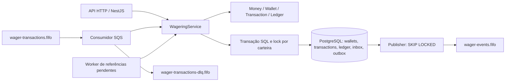
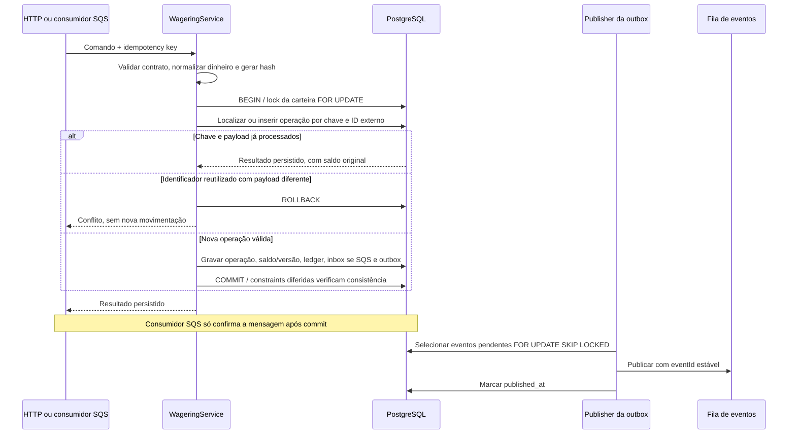
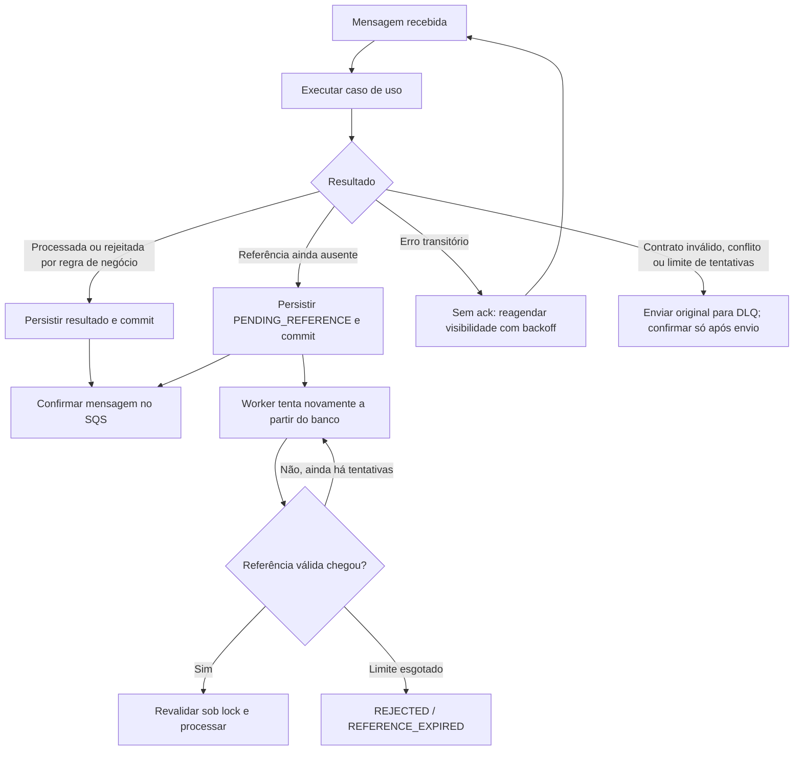

# Jungle Wagering Processor: fluxos de implementação

Este documento acompanha o teste técnico implementado neste repositório. Os diagramas representam o código em `src/application/wagering.ts`, `src/messaging/workers.ts` e as garantias de `src/persistence/migrations/initial.ts`. As decisões completas e as condições de validação permanecem em [ARCHITECTURE.md](../ARCHITECTURE.md) e [VALIDATION.md](../VALIDATION.md).

## 1. Arquitetura e limites

HTTP e SQS são duas entradas para o mesmo serviço de aplicação. O Compose inicia três instâncias da mesma aplicação, não três microsserviços com domínios separados. Todas usam PostgreSQL e as filas do LocalStack. As classes de domínio não dependem de NestJS, TypeORM ou SQS; o serviço de aplicação conhece o EntityManager do TypeORM.

O saldo, a operação, o lançamento no ledger, a inbox quando a entrada é SQS e a outbox são persistidos na mesma transação SQL. A publicação do evento ocorre depois desse commit. A outbox evita que uma movimentação confirmada dependa de um envio síncrono bem-sucedido à fila.

Este não é um fluxo de saga entre bancos independentes. Uma falha antes do commit provoca rollback SQL; depois do commit, a recuperação depende de dados persistidos, repetição idempotente e publicação posterior da outbox.

## 2. Transação, concorrência e idempotência

O lock serializa movimentações da mesma carteira, mas não bloqueia carteiras independentes entre si. UNIQUEs protegem a chave de idempotência, o identificador externo e o lançamento por carteira/transação. Repetir uma operação terminal devolve o resultado original; não aplica um segundo débito nem substitui o resultado pelo saldo atual.

`Money` usa centavos em `bigint`, sem aritmética financeira em ponto flutuante. PostgreSQL persiste valores como `numeric(20,2)`. O ledger é append-only, com triggers contra alteração e constraints de consistência. Ele registra movimentações de carteira; não é uma implementação de contabilidade de partidas dobradas.

## 3. Falhas e recuperação

### Queda depois do commit e antes do ack

O SQS pode entregar a mensagem novamente. A inbox e a idempotência no PostgreSQL impedem uma nova movimentação financeira. A deduplicação não depende somente da janela de deduplicação FIFO.

### Queda depois do envio do evento e antes de marcar a outbox

O publisher pode reenviar o evento. A garantia é **at-least-once**, não exactly-once. O `eventId` é estável para que consumidores externos possam deduplicar em armazenamento persistente. Publishers concorrentes podem publicar eventos da mesma carteira fora de ordem; projeções de saldo devem considerar `walletVersion`.

### Referência fora de ordem

REFUND ou ROLLBACK que chegam antes da operação referenciada podem ficar em `PENDING_REFERENCE`. A pendência fica no banco, sobrevive a reinícios e é reavaliada pelo worker com backoff e limite de tentativas. Ao expirar, torna-se terminal; uma referência recebida depois não reabre a operação.

### Reconciliação e limites

A reconciliação compara o saldo materializado com a soma dos lançamentos sob lock e sinaliza divergências, sem corrigi-las automaticamente. O projeto não tem interface, autenticação ativa, benchmark ou implantação pública. As portas do Compose são locais. Os cenários e resultados efetivamente verificados estão em [VALIDATION.md](../VALIDATION.md); não se deve confundir testes de concorrência funcional com medição de capacidade de produção.
